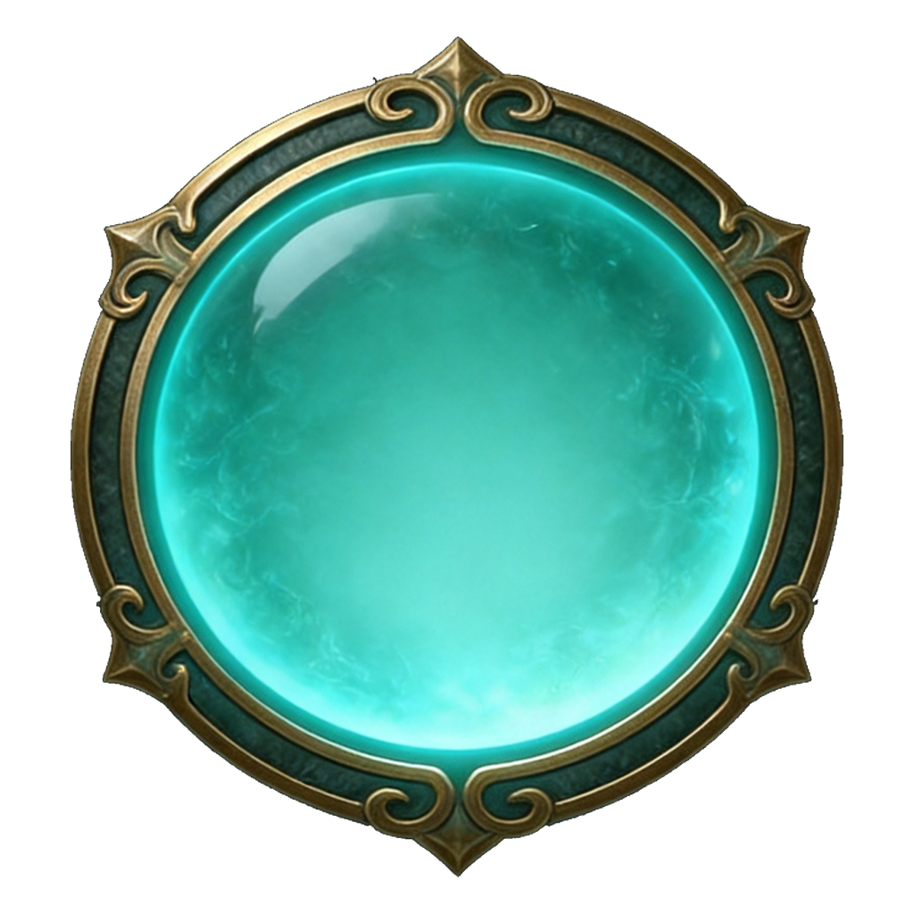

# HUD-ORB v1.8 · Play 主界面 HUD：资源球 + 左上信息 + 辅读/触控 + 系统按钮 + 武位栏

《我的 AI 队友不可能是上古器灵！》Play 主界面的气血（命）、灵力（灵）资源球，左上境界 / 波次 / 本局资源，翻滚就绪辅读条，竖屏触控摇杆与跳跃/翻滚，右上全屏 + 菜单按钮，以及底部武位栏。
资源球、境界玉槽、武位底版是生图 PNG；其余线框是脚本生成的 SVG 或纯 CSS。文字和动效都由 HTML/CSS 叠加。

**统一线条语言**：金色外线（1px）+ 委角转角 + 淡玉内线 + 金菱珠 / 小金点。新组件照此延续，不要引入实心玉牌或西式纹样。

## 1. 包内容

| 路径 | 说明 |
|------|------|
| `png/hud-orb-qi-01-1x1.png` | 灵球底版，1024×1024 透明 PNG |
| `png/hud-orb-life-01-1x1.png` | 命球底版，与灵球外框完全一致 |
| `png/hud-realm-mark.svg` | 境界环纹：八瓣菱花镜（矢量），衬在标题左上 |
| `png/hud-realm-track.png` | 境界进度玉槽（金角 + 青玉槽） |
| `png/hud-realm-fill.png` | 槽内已修进度的玉石纹理（成品图，无生成脚本） |
| `png/hud-wave-frame.svg` | 波次镂空横匾三宫格（中间透空） |
| `png/hud-wave-crest.svg` | 横匾顶中云头宝珠 |
| `png/hud-dash-frame.svg` | 翻滚就绪辅读条：紧凑委角金框 + 左卷勾（96×22 三宫格） |
| `png/hud-joystick-ring.svg` | 摇杆外环（annulus 暗底 + 淡玉晕 + 金/玉线） |
| `png/hud-joystick-knob.svg` | 摇杆内盘（同圆钮语言，逻辑层位移） |
| `png/hud-btn-action.svg` | 跳跃/翻滚共用圆钮底版 |
| `png/hud-btn-frame.svg` | 菜单按钮三宫格（委角金框 + 暗底 + 两侧金菱） |
| `png/hud-btn-square.svg` | 全屏方钮底框 |
| `png/hud-wpn-dock.png` | 底部武位栏底版：玉管 + 金框 + 6 块委角玉片（1600×386） |
| `png/hud-wpn-dock-lit.png` | 点亮版底版；当前武位按格裁出 |
| `png/hud-wpn-dock.json` | 格位与玉管的百分比几何 |
| `orb-gem.json` | 宝珠圆的实测位置（占底版比例） |
| `hud-orb.css` | 命/灵：叠字、玉质动效、token 默认值 |
| `hud-bar.css` | 境界、波次横匾、本局资源、翻滚就绪辅读、竖屏叠放、右上系统按钮、底部武位栏 |
| `hud-touch.css` | 竖屏触控摇杆、跳跃/翻滚圆钮 |
| `demo.html` | 直接打开即可预览全部组件 |
| `scripts/build-orb-plates.py` | 由 `source/` 重新生成两张球底版 |
| `source/hud-orb-qi-01-1x1.src.png` | 灵球源图（已抠图、居中） |
| `scripts/build-realm-mark-svg.py` | 生成境界环纹 `hud-realm-mark.svg`（纯代码，无源图） |
| `scripts/build-realm-track.py` | 由源图抠出金角玉槽 `hud-realm-track.png` |
| `scripts/build-wave-frame-svg.py` | 生成横匾 `hud-wave-frame.svg` + 宝珠 `hud-wave-crest.svg`（纯代码） |
| `scripts/build-dash-frame-svg.py` | 生成辅读条框 `hud-dash-frame.svg`（纯代码） |
| `scripts/build-touch-controls-svg.py` | 生成摇杆 + 圆钮 SVG（纯代码） |
| `scripts/build-hud-btn-svg.py` | 生成按钮框 `hud-btn-frame.svg` + `hud-btn-square.svg`（纯代码） |
| `scripts/build-wpn-dock.py` | 由玉器三联屏拼 6 格底版 + 点亮版（需要 Pillow） |
| `source/hud-realm-track-21x9.jpg` | 金角玉槽原图 |
| `source/hud-run-strip-01-16x9.png` | 玉器三联屏原图（拼武位栏用） |
| `manifest.json` | 组件 ID 与资产映射 |

## 2. 组件

| ID | 名称 | 底版 | 变体 class | 叠字 |
|----|------|------|-----------|------|
| HUD-ORB-LIFE-01 | 命球（气血） | `hud-orb-life-01-1x1.png` | `play-hud-orb-gem--life` | 命 + `当前 / 上限` |
| HUD-ORB-QI-01 | 灵球（灵力） | `hud-orb-qi-01-1x1.png` | `play-hud-orb-gem--qi` | 灵 + `当前 / 上限` |
| HUD-REALM-01 | 境界 | 玉槽 `hud-realm-track.png` + 环纹 `hud-realm-mark.svg` | `play-hud-realm` | `炼体 · 上`；右侧 `14/29` |
| HUD-WAVE-01 | 波次 | `hud-wave-frame.svg` + `hud-wave-crest.svg` | `play-hud-wave`（`--battle` / `--desktop`） | `第 N 波结算` + `休整`；战斗 `第 N 波` + `mm:ss` |
| HUD-RUN-LIST-01 | 本局资源 | 无（纯 CSS） | `play-hud-run`（`--desktop`） | 2×2：`灵石` `击破` `敌影` `器物 / 遗蕴` |
| HUD-BTN-ROLL-READY-01 | 翻滚就绪辅读 | `hud-dash-frame.svg` | `play-hud-dash`（`--cd`） | `Shift` + `翻滚` + `就绪` / `冷却 Ns` |
| HUD-JOYSTICK-01 | 虚拟摇杆 | `hud-joystick-ring.svg` + `knob` | `play-hud-joystick` | 无（内盘拖动） |
| HUD-BTN-JUMP-01 | 跳跃 | `hud-btn-action.svg` | `play-hud-touch-btn--jump` | `跳跃` 居中 |
| HUD-BTN-ROLL-01 | 翻滚 | `hud-btn-action.svg` | `play-hud-touch-btn--roll` | `翻滚` 居中 |
| HUD-BTN-SYS-ICON-01 | 全屏 | `hud-btn-square.svg` | `play-hud-sys__icon` | 全屏角标图标 |
| HUD-BTN-LOADOUT-01 | 菜单 | `hud-btn-frame.svg` | `play-hud-sys__menu` | `☰ 菜单` + Esc 键帽 |
| HUD-BTN-ESC-01 | Esc 键帽 | 无（纯 CSS） | `play-hud-sys__key` | `Esc`，触屏隐藏 |
| HUD-WPN-DOCK-01 | 底部武位栏 | `hud-wpn-dock.png` + `hud-wpn-dock-lit.png` | `play-hud-dock`（`--desktop`） | 玉管：`修为` + `14 / 20`；6 格武器名 / `武N·空` |
| HUD-WPN-SLOT-EMPTY | 空武位 | 底版玉片（无叠层） | `play-hud-wpn--empty` | 金菱 + `武N·空`，完整显示 |
| HUD-WPN-SLOT-ACTIVE | 当前武位 | 点亮版按格裁出 | `play-hud-wpn--active` | 充能环「充」+ 武器名，完整显示、可换行 |

## 3. DOM 结构

```html
<div class="ui-art ui-art--hud-orb">
  
  <div class="play-hud-orb-gem play-hud-orb-gem--qi">
    <span class="play-hud-orb-gem__vfx" aria-hidden="true"></span>
    <span class="play-hud-orb-gem__vfx play-hud-orb-gem__vfx--2" aria-hidden="true"></span>
  </div>
  <div class="ui-art__content">
    <span class="play-hud-orb-char">灵</span>
    <strong class="play-hud-orb-value">360 / 360</strong>
  </div>
</div>
```

尺寸只改一个变量：`--hud-orb-size`（默认 96px），字号、动效都按它等比缩放。

## 4. 底版规则

- 两张底版 **同一外框**：命球由灵球源图只旋转宝珠色相得到（饱和度、明度、高光保留），因此透亮度一致、外框像素级相同。**不要单独生图出命球。**
- 外框占画布 92%，居中。宝珠圆心 (50%, 50%)，**半径 35%**。
- 不得烘焙文字、数字、水印。

## 5. 叠字规则

| 项 | 值 |
|----|----|
| 叠字区 `inset` | `24% 20% 24% 20%`（完全落在宝珠圆内） |
| 排列 | 单字在上、数值在下，整组垂直、水平居中 |
| 单字 | `--ui-font-title`，`0.24 × --hud-orb-size` |
| 数值 | `--ui-font-number`，`0.11 × --hud-orb-size`，tabular-nums |
| 颜色 | 暖白 `#fffbee`，两层深色阴影 |

| `--hud-orb-size` | 单字 | 数值 | 用途 |
|------------------|------|------|------|
| 96px | 23px | 10.6px | 验收 / 横屏 |
| 72px | 17px | 7.9px | 数值可读的最小建议尺寸 |
| 50px | 12px | 5.5px | 不建议，数值看不清 |

## 6. 玉质动效

| 层 | 效果 | 灵 | 命 |
|----|------|----|----|
| `.play-hud-orb-gem::before` | 圆周内发光呼吸（透明度 0.3↔1） | 5s | 3.6s |
| `.play-hud-orb-gem__vfx` | 玉面柔光带掠过 | 6s | 5s |
| `.play-hud-orb-gem__vfx--2` | 玉中流光：亮弧沿圆周旋转 | 9s | 6s |
| `.play-hud-orb-gem::after` | 球心静止淡暗底，托住文字 | — | — |

- 光带遮掉球心 38% 以内，流光只在外圈 58% 以外，文字区域不闪、不变色。
- `prefers-reduced-motion` 时停止呼吸与光带。
- 节奏可用 `--orb-breathe`、`--orb-sheen-dur`、`--orb-flow-dur` 覆盖。

## 7. 重新生成底版

```bash
python3 scripts/build-orb-plates.py
```

需要 Pillow。脚本读取 `source/`，清理杂点、居中归一化，输出两张底版和 `orb-gem.json`。

## 8. 验收清单

- [ ] 两球外框同大，底缘完整
- [ ] 命球与灵球同样透亮，外框镶边未被染红
- [ ] 单字和数值都在宝珠内，不被裁切、不压外框
- [ ] 动效在任意帧都不影响文字可读性

## 9. 左上信息与右上系统按钮

9.1–9.3 是左上三块和竖屏叠放，9.4 是右上系统按钮，9.5 是底部武位栏。境界玉槽从黑底 JPG 重抠，**不要**从已经抠过的 PNG 再抠。

### 9.1 境界 HUD-REALM-01

**不要方框。** 字、细尺、底行是同一宽度的一块，整组浮在场景上。`14/29` 只写一次（头行右侧，对标 Lv）。

组件由三层组成，从下到上：

1. **环纹** `hud-realm-mark.svg`：八瓣菱花镜，圆心压在框线转角，向左上溢出组件。
2. **框线** `play-hud-realm__rule`：L 形金线框住标题，转角是菱形金珠 + 回纹卷勾。
3. **内容**：标题、`14/29`、玉槽进度、底行。

```html
<div class="play-hud-realm">
  <div class="play-hud-realm__head">
    <div class="play-hud-realm__name">
      
      <i class="play-hud-realm__rule" aria-hidden="true">
        <i class="play-hud-realm__rule-grid"></i><i class="play-hud-realm__rule-inner"></i>
        <svg class="play-hud-realm__rule-corner" viewBox="0 0 18 18"><path class="curl" d="M9.5 5h3.2a2.2 2.2 0 1 1-2.2 2.2M5 9.5v3.2a2.2 2.2 0 1 0 2.2-2.2"/><path class="gem" d="M5 1.5 8.5 5 5 8.5 1.5 5Z"/></svg>
        <b class="play-hud-realm__rule-end play-hud-realm__rule-end--x"></b><b class="play-hud-realm__rule-end play-hud-realm__rule-end--y"></b>
      </i>
      <span class="play-hud-realm__title">炼体</span><span class="play-hud-realm__grade">· 上</span>
    </div>
    <span class="play-hud-realm__lv">14<span>/29</span></span>
  </div>
  <div class="play-hud-realm__bar" style="--realm-progress:0.48"><i class="play-hud-realm__bar-fill"></i></div>
  <div class="play-hud-realm__foot"><span>此间修行</span></div>
</div>
```

桌面 / 横屏再加 `play-hud-realm--desktop`。环纹和框线必须放在 `play-hud-realm__name` 里面，它们按标题块定位。

#### 尺寸

| 项 | 竖屏 | 横屏 / 桌面 |
|----|------|-------------|
| `--realm-w`（内容宽，记作 W） | 200px | 252px |
| 内容高 | 约 63px | 约 73px |
| 让位 `--realm-bleed` | 0.2W = 40px（左、上各一份） | 0.2W = 50px |
| 实际占位（含让位） | 244×113 | 306×133 |
| 标题 / 品阶 / 底行字号 | 26 / 15 / 10px | 30 / 17 / 11px |
| 玉槽高 `--realm-bar-h` | 8px | 10px |

组件按左上角放置时，内容会向右下偏移一份让位。安全区边距从组件外框算，不要从标题算。

#### 环纹

| 项 | 值 |
|----|----|
| 直径 | 0.38W（竖屏约 76px，横屏约 96px） |
| 圆心 | 标题块左上角，即框线转角、玉槽左端正上方 |
| 下沿 | 停在玉槽上方，不压进度条和底行 |
| 透明度 | 0.46 |
| 渐隐 | 径向遮罩，左上最实，往右下淡出，不抢标题和 `14/29` |
| 结构（外→内） | 八瓣菱花双线外廓 + 瓣间金珠；瓣尖如意云头（正向大、斜向小，正向另加菱形）；联珠环；栉齿纹；一粗两细玉环；中心四瓣柿蒂 + 四乳钉 + 纽 |
| 用色 | 外层淡金 `#ecd6a0`，内层淡玉青 `#d6ecde` |

环纹是纯线稿矢量，不是照片素材。不要换成西式星纹、实心玉璧浮雕或复杂缠枝满铺；缩到 76px 时要能看出菱花外轮廓和粗环。

#### 框线

| 项 | 值 |
|----|----|
| 范围 | 宽为标题块的 82%，高为 92%，竖线下端留 12% |
| 主线 | 1px 金线，从转角往外由实到虚 |
| 内线 | 往内 4px 的淡玉色细线，135° 渐隐 |
| 点阵 | 转角内侧 26%×56% 的十字点，径向渐隐，不压字 |
| 转角 | 菱形金珠 + 两个回纹卷勾，带柔光 |
| 端点 | 横线右端、竖线下端各一个 3px 小金菱 |

#### 进度

| 项 | 值 |
|----|----|
| 变量 | `--realm-progress`，填 **0–1 的比例**（如 `0.48`），不是百分比 |
| 边界 | 填充只在两端金帽之间：`--realm-cap: 7.8%`，满值不越过金帽 |
| 质感 | 填充贴 `hud-realm-fill.png` 玉石纹理，不是纯色块 |

### 9.2 波次 HUD-WAVE-01

**镂空横匾**，不是实心牌子：中间完全透空，只有线框，文字浮在场景上，身后一层很淡的暗晕保证可读。线条语言与境界框线一致（1px 金线、淡玉内线、金菱珠）。

```html
<div class="play-hud-wave">
  
  <small class="play-hud-wave__label">第 1 波结算</small>
  <strong class="play-hud-wave__state">休整</strong>
</div>
```

战斗态加 `play-hud-wave--battle`，文案换成 `第 1 波` + `02:35`（宝珠自动隐藏）；横屏顶中加 `play-hud-wave--desktop`。

#### 竖屏叠放

见 §9.3：REALM、WAVE、RUN 三块放进同一个 `.play-hud-stack`。横匾两端金菱珠落在进度条两端金帽正下方。

#### 线框

| 部件 | 规则 |
|------|------|
| 外框 | 1px 金线；四角委角（内凹圆角），外侧各出一枚卷草镂空卷勾 |
| 内框 | 往内 3px 的淡玉细线，同样委角 |
| 两端 | 如意收口 + 金菱珠，对应境界进度条两端金帽 |
| 顶中 | 云头宝珠 `hud-wave-crest.svg`，只在休整态显示 |
| 三宫格 | `border-image: url(png/hud-wave-frame.svg) 0 36 fill / 0 var(--wave-cap) stretch`；收口宽 = 高，中段只有直线，可任意拉长 |

#### 尺寸与字号

| 规格 | 宽×高 | 小字 | 大字 |
|------|-------|------|------|
| 竖屏休整 | 200×34 | 10px | 13.6px「休整」金色 |
| 竖屏 / 横屏战斗 `--battle` | 200×28 | 10px | 12px 时间，数字字体 |
| 横屏顶中休整 `--desktop` | 260×44 | 13px | 17.6px「休整」金色 |

- 字号按高度算：小字 `0.3 × --wave-h`，大字 `0.4 × --wave-h`（战斗态固定 10 / 12）。
- 横匾内净高只有外框的 47%。大字不得超过内框净高，上下至少留 2px；**不要排两行字**，横屏也用单行。
- 改尺寸只改 `--wave-w` / `--wave-h`，收口、宝珠、字号跟着缩放。

### 9.3 本局资源 HUD-RUN-LIST-01

**镂空条带**，纯 CSS，没有底图。不套框（它紧挨着 WAVE 横匾，再套框会重复），线条语言与境界、横匾一致。

```html
<div class="play-hud-run">
  <i class="play-hud-run__spine" aria-hidden="true"></i>
  <svg class="play-hud-run__curl" viewBox="0 0 14 10" aria-hidden="true"><path d="M1.5 1.5h5.2a2.4 2.4 0 1 1-2.4 2.4"/></svg>
  <div class="play-hud-run__row">
    <div class="play-hud-run__cell play-hud-run__cell--gold"><span>灵石</span><b>16500</b></div>
    <i class="play-hud-run__sep" aria-hidden="true"></i>
    <div class="play-hud-run__cell"><span>击破</span><b>11</b></div>
  </div>
  <div class="play-hud-run__row">
    <div class="play-hud-run__cell"><span>敌影</span><b>0</b></div>
    <i class="play-hud-run__sep" aria-hidden="true"></i>
    <div class="play-hud-run__cell"><span>器物</span><b>0/4</b></div>
  </div>
</div>
```

横屏加 `play-hud-run--desktop`，第四项标签用全称「遗蕴」。

#### 部件

| 部件 | 规则 |
|------|------|
| 左脊 | 1px 金线贯穿两行；上端 5px 金菱珠 + 如意卷勾，下端 3.5px 小金菱 |
| 条带 | 每行一条淡玉薄带，从左往右渐隐；顶边淡玉细线，底边金细线，同样往右淡出 |
| 分隔 | 两格之间一颗 4px 小金菱 |
| 格 | 标签左、数值右，不折行；标签超宽时截断标签，不截数值 |
| 字 | 标签 muted、标题字体；数值数字字体 tabular-nums；「灵石」数值金色 `--ui-gold-2`，其余暖白 |

#### 尺寸

| 项 | 竖屏 | 横屏 |
|----|------|------|
| 宽×高 | 200×52 | 252×60 |
| 行高 / 行距 | 20 / 4 | 24 / 4 |
| 标签 / 数值 | 10 / 12px | 11 / 14px |

改宽只改 `--run-w`；放进 `.play-hud-stack` 时自动取 REALM 内容宽。

#### 竖屏左上叠放

```html
<div class="play-hud-stack">
  <div class="play-hud-realm">…</div>
  <div class="play-hud-wave">…</div>
  <div class="play-hud-run">…</div>
</div>
```

| 规则 | 值 |
|------|----|
| 间距 | 8px |
| 宽度 | WAVE、RUN 自动取 REALM 内容宽 `--realm-w`（200） |
| 左缘 | 对齐 REALM 内容左缘：REALM 外框 left + 0.2W + 2 |
| 竖线 | REALM 框线竖线、WAVE 左端金菱珠、RUN 左脊落在同一竖线上 |
| 总占位 | 244×216（含 REALM 左上让位） |

不要让 WAVE / RUN 比 REALM 宽，也不要单独给它们设左边距。

可选第 4 块：**翻滚就绪**（见 §9.3.1），接在 RUN 下，**内容宽**、不拉满 `--realm-w`。

### 9.3.1 翻滚就绪 HUD-BTN-ROLL-READY-01

**只读辅读条**，`role="status"`，`pointer-events: none`。不是按钮，没有 RUN 同款左脊玉条；视觉层级最低，比 REALM/WAVE/RUN 更小更淡。

```html
<div class="play-hud-dash" role="status">
  <div class="play-hud-dash__plate">
    <span class="play-hud-dash__lead">
      <kbd class="play-hud-dash__key">Shift</kbd>
      <span class="play-hud-dash__label">翻滚</span>
    </span>
    <span class="play-hud-dash__tail">
      <i class="play-hud-dash__sep" aria-hidden="true"></i>
      <strong class="play-hud-dash__state">就绪</strong>
    </span>
  </div>
</div>
```

冷却态加 `play-hud-dash--cd`，状态文案改为 `冷却 1.2`（数字字体 tabular-nums）。

#### 线框

| 部件 | 规则 |
|------|------|
| 外框 | `hud-dash-frame.svg` 三宫格：`border-image: url(png/hud-dash-frame.svg) 0 10 fill / 0 var(--dash-cap) stretch` |
| 语言 | 1px 淡金线 + 淡玉内线 + 左端卷勾与小金菱；半透明暗底 |
| 键帽 | 纯 CSS 小键帽，非可点 |

#### 尺寸与放置

| 项 | 值 |
|----|-----|
| 行高 `--dash-row` | 22px |
| 就绪占位 | 约 105×22 |
| 冷却占位 | 约 121×22 |
| 最大宽 | 156px（`max-content`） |
| 整体透明度 | 0.86 |
| 竖屏 | 放进 `.play-hud-stack` 为第 4 块；左缘与 RUN 一致（`margin-left: 2px + 0.2W`），上距 RUN 2px |
| 横屏 | **不**接 stack 全宽；独立放在左下安全区（示例：left 12px、bottom 10px，相对 Play 视口） |

### 9.4 右上系统按钮（全屏 + 菜单 + Esc）

按最新版布局：**左边全屏方钮，右边菜单按钮，Esc 键帽在菜单按钮右端**。两个按钮各自独立，不做成同一块。

```html
<div class="play-hud-sys play-hud-sys--touch">
  <button type="button" class="play-hud-sys__icon" aria-label="全屏">
    <svg viewBox="0 0 24 24" aria-hidden="true"><path d="M4 9V4h5M15 4h5v5M20 15v5h-5M9 20H4v-5"/></svg>
  </button>
  <button type="button" class="play-hud-sys__menu">
    <svg viewBox="0 0 24 24" aria-hidden="true"><path d="M4 6h16M4 12h16M4 18h16"/></svg>
    <span>菜单</span>
    <kbd class="play-hud-sys__key">Esc</kbd>
  </button>
</div>
```

| 修饰 class | 作用 |
|-----------|------|
| `play-hud-sys--desktop` | 横屏 / 桌面：高 36、间距 16、字号 14 |
| `play-hud-sys--touch` | 触屏：隐藏 Esc 键帽（另有 `(hover: none) and (pointer: coarse)` 媒体查询兜底） |
| `play-hud-sys--no-fullscreen` | iPhone 等不支持全屏：隐藏全屏方钮，菜单右缘位置不变 |

#### 线框

与境界框线、波次横匾同一套线。按钮要可点，框内保留一层半透明暗底（横匾、条带是透空的，按钮不是）。

| 部件 | 规则 |
|------|------|
| 全屏方钮 | `hud-btn-square.svg` 整张铺满；委角金框 + 淡玉内线 + 四角金点 + 顶中小金菱；图标暖白 |
| 菜单按钮 | `hud-btn-frame.svg` 三宫格：`border-image: … 0 18 fill / 0 calc(var(--sys-h) * 0.5) stretch`；两侧小金菱 |
| 菜单内容 | 金色 ☰ + 暖白「菜单」，水平垂直居中 |
| Esc 键帽 | 纯 CSS：淡玉细框、底边金线、半透明暗底；数字字体 11px，muted 色 |
| 交互 | hover 提亮 14%；按下下移 1px；键盘焦点淡玉描边 |

#### 尺寸

| | 竖屏（触屏） | 横屏（键盘） | iPhone |
|--|------|------|------|
| 高 `--sys-h` | 44 | 36 | 44 |
| 全屏方钮 | 44×44 | 36×36 | 不显示 |
| 菜单按钮 | 88×44（无 Esc） | 118×36（带 Esc） | 88×44 |
| 两钮间距 | 12 | 16 | — |
| 字号 `--sys-font` | 15 | 14 | 15 |

改尺寸只改 `--sys-h` / `--sys-font`；菜单最小宽 = 2 × 高，收口宽 = 0.5 × 高。

#### 放置

- 右上：right = 安全区边距，top = 安全区边距（竖屏 `edge-top`，横屏 20）。
- 竖屏时按钮组中线与 REALM 标题行齐平；横屏与顶中 WAVE 横匾同高。
- 按钮文字按最新版为「菜单」（原「整装」）；菜单里的「画面 → 显示模式」仍保留全屏开关。
- Esc 显隐判定与输入提示一致：键盘 / 手柄显示，触屏隐藏。

### 9.5 底部武位栏（修为玉管 + 6 格玉片）

一整块玉器底版，不要再拆成 6 张独立暗玉片。比例固定 **4.1468 : 1**，只改 `--dock-w`。

```html
<div class="play-hud-dock" style="--wpn-current:0">
  <div class="play-hud-dock__xp" style="--xp-progress:0.7">
    <span>修为</span><b>14<small> / 20</small></b>
  </div>
  <i class="play-hud-dock__lit" aria-hidden="true"></i>
  <div class="play-hud-dock__slots">
    <button type="button" class="play-hud-wpn play-hud-wpn--active">
      <span class="play-hud-wpn__ring" style="--wpn-charge:0.72">充</span>
      <span class="play-hud-wpn__name" style="--wpn-name-scale:1;--wpn-name-track:0.12em">鸣律</span>
    </button>
    <button type="button" class="play-hud-wpn play-hud-wpn--empty">
      <i class="play-hud-wpn__gem" aria-hidden="true"></i>
      <span class="play-hud-wpn__name" style="--wpn-name-scale:0.86;--wpn-name-track:0.02em">武2·空</span>
    </button>
    <!-- 其余 4 格同 empty / 有武器 -->
  </div>
</div>
```

开局全空时不要放 `.play-hud-dock__lit`。`--wpn-current` 是 **0-based** 当前格。`--xp-progress`、`--wpn-charge` 都是 0–1。

#### 底版怎么来

`scripts/build-wpn-dock.py` 读 `source/hud-run-strip-01-16x9.png`：

| 段 | 规则 |
|----|------|
| 玉管 | 两端铜盖用原图，只拉长中段 |
| 第 1 格 | 原图左格（带左外缘挂钩、卷角） |
| 第 2–5 格 | 原图中格 |
| 第 6 格 | 第 1 格水平镜像（原图右格有松树，不用） |
| 水印 | 源图 y≥1172 的「AI生成」不取 |
| 点亮版 | 同结构：金框提亮、玉片内柔光、外缘淡玉晕 |

几何写在 `png/hud-wpn-dock.json`。格区：左右 2.02%、顶 20.2%、底 1.2%、缝 0.926% 栏宽、单格 15.223% 栏宽。

#### 玉管修为

| 项 | 规则 |
|----|------|
| 位置 | 落在管子中段，不铺满整管（top 4.4%、高 12%、左右 5.6%） |
| 字 | 金色 `#ffe7a0`，**无描边**；竖屏 10px / 横屏 13px |
| 底 | 字下半透明墨绿圆角块 `rgb(8 28 24 / 18%)`，只托对比度 |
| 进度 | 已修为段 `multiply` 略深玉；未修为段压 20%；交界金线 |

#### 武位格

| 状态 | 规则 |
|------|------|
| 空位 | 底版原样；金菱占位 + 墨绿 `武N·空` |
| 有武器 | 浅玉珠 + 细金弧 `--wpn-charge`；中间「充」；底下武器名 |
| 当前 | `.play-hud-dock__lit` 按 `--wpn-current` clip 出那一格；名字略加粗 |
| 名字 | **禁止省略号**。按字数缩 `--wpn-name-scale` / `--wpn-name-track`，超过 4 字可换行（`word-break: break-all`） |

字数缩放：≤2 → 1 / 0.12em；≤3 → 0.96；≤4 → 0.9 / 0.06em；≤6 → 0.86 / 0.02em；≤8 → 0.82；更长 → 0.74。

#### 尺寸与放置

| | 竖屏 | 横屏 `--desktop` |
|--|------|------|
| 栏宽 `--dock-w` | 374 | 520 |
| 栏高（比例算出） | 90 | 125 |
| 武位字 `--wpn-font` | 11 | 14 |
| 放置 | 底边居中，贴 `edge-bottom` | 底中，可与命/灵球同一带 |

改宽只改 `--dock-w`，不要单独改高。

### 9.8 竖屏触控（摇杆 + 跳跃 / 翻滚）

竖屏 `activeDevice=touch` 时显示；横屏键鼠隐藏。视觉比菜单方钮**更轻**，但需能看清「半透明暗底 + 金/玉线」，不是空线框。

#### 摇杆 HUD-JOYSTICK-01

```html
<div class="play-hud-joystick">
  <div class="play-hud-joystick__ring" aria-hidden="true"></div>
  <div class="play-hud-joystick__knob" aria-hidden="true" style="transform: translate(0, 0)"></div>
</div>
```

| 项 | 值 |
|----|-----|
| 尺寸 | 外环 112×112，内盘 48×48，默认几何居中 |
| 外环 | annulus 暗底 ~38% + 淡玉晕；金/玉线分绘 |
| 内盘 | 同圆钮 ~48% 暗底 + 内晕；由逻辑 `transform: translate(x,y)` 拖动 |
| 放置 | 左下，武位顶 + 安全间距（见布局规范） |

#### 圆钮 HUD-BTN-JUMP-01 / HUD-BTN-ROLL-01

```html
<button type="button" class="play-hud-touch-btn play-hud-touch-btn--jump">
  <span class="play-hud-touch-btn__label">跳跃</span>
</button>
<button type="button" class="play-hud-touch-btn play-hud-touch-btn--roll">
  <span class="play-hud-touch-btn__label">翻滚</span>
</button>
```

| 项 | 跳跃 | 翻滚 |
|----|------|------|
| 尺寸 | 64 | 60（`--roll` 修饰） |
| 底版 | 共用 `hud-btn-action.svg` | 同左 |
| 文案 | 圆心居中 | 同左 |
| 按下 | `scale(0.94)` | 同左 |

样式表：`hud-touch.css`（依赖 `hud-bar.css` 内 `--ui-font-*` token）。

### 9.6 重新生成素材


```bash
python3 scripts/build-realm-track.py     # 需要 Pillow，输出 png/hud-realm-track.png
python3 scripts/build-realm-mark-svg.py  # 无依赖，输出 png/hud-realm-mark.svg
python3 scripts/build-wave-frame-svg.py  # 无依赖，输出 png/hud-wave-frame.svg + hud-wave-crest.svg
python3 scripts/build-dash-frame-svg.py  # 无依赖，输出 png/hud-dash-frame.svg
python3 scripts/build-touch-controls-svg.py  # 无依赖，输出 joystick + hud-btn-action.svg
python3 scripts/build-hud-btn-svg.py     # 无依赖，输出 png/hud-btn-frame.svg + hud-btn-square.svg
python3 scripts/build-wpn-dock.py        # 需要 Pillow，输出 png/hud-wpn-dock.png + hud-wpn-dock-lit.png + hud-wpn-dock.json
```

环纹、横匾、按钮框的形状和线宽都在对应脚本里改，改完重新运行，不要手改 SVG。武位底版不要手改 PNG，改裁切或点亮参数后重跑 `build-wpn-dock.py`。

### 9.7 验收

- [ ] 境界无方框，字浮在场景上
- [ ] 环纹是完整正圆，没有被容器或屏幕边缘裁掉
- [ ] 环纹圆心在框线转角，下沿不压玉槽和底行
- [ ] 环纹是中式菱花镜，不是西式星纹
- [ ] 框线转角有金珠和卷勾，点阵不压标题
- [ ] `14/29` 只出现一次
- [ ] 进度填充不越过两端金帽，有玉石纹理，随 `--realm-progress` 变化
- [ ] 波次横匾中间透空，四角卷勾、两端金菱珠完整
- [ ] 「休整」和时间不压内框玉线，两位数波次也放得下
- [ ] 竖屏 WAVE 与 REALM 同宽同左缘，间距 8
- [ ] 本局资源四项标签左、数值右，两位以上数值不折行
- [ ] 竖屏 REALM / WAVE / RUN 三块左缘在同一竖线，间距 8
- [ ] 翻滚就绪明显小于 RUN，竖屏接 RUN 下且不拉满 200 宽；横屏仅为左下小块
- [ ] 翻滚就绪不是按钮、无 RUN 左脊；就绪/冷却文案可读
- [ ] 右上全屏方钮在菜单左侧，两钮同高同线框，间距 12 / 16
- [ ] 菜单按钮文字为「☰ 菜单」且居中；Esc 键帽只在键盘 / 手柄时显示
- [ ] iPhone 不显示全屏方钮，菜单右缘位置不变
- [ ] 竖屏 44 高（88×44 菜单）、横屏 36 高（118×36 菜单）
- [ ] 武位栏是一整块玉器（玉管 + 6 格），不是 6 张碎玉片
- [ ] 玉管「修为」「14 / 20」金色可读，字下只有淡阴影块、无描边
- [ ] 当前武位金框是点亮版裁出，不是另画黄线
- [ ] 武器名和「武N·空」完整显示，没有省略号
- [ ] 竖屏 374×90、横屏 520×125，比例 4.1468 : 1
- [ ] 摇杆外环/内盘能看出半透明暗底，不是仅线框；内盘默认居中
- [ ] 跳跃/翻滚文案圆心居中；圆钮暗底弱于菜单方钮
- [ ] 触控键与武位栏不重叠
